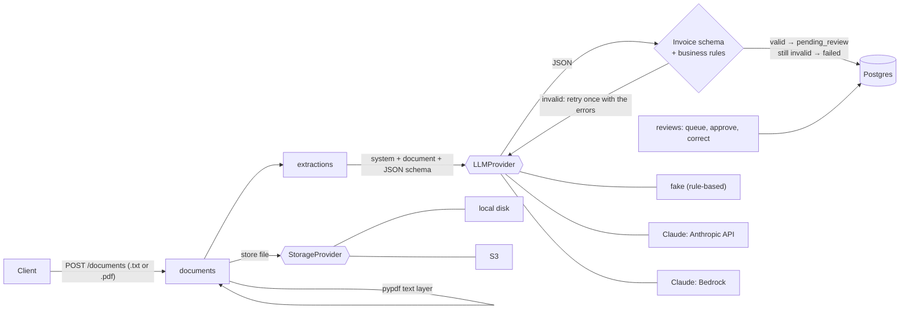
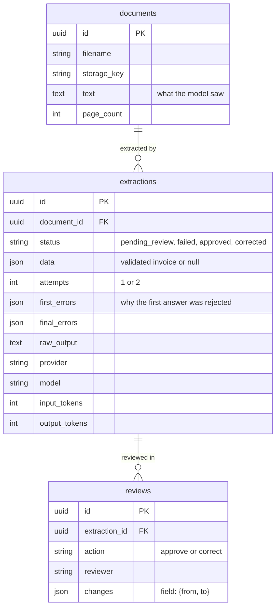

# llm-document-extraction

Turn invoices (text or PDF) into structured, validated data with an LLM, and keep a person in the loop:
1. The model's output must pass a strict Pydantic schema, including business rules such as "the line items add up to the subtotal".
2. If it doesn't, the model gets **one retry that shows it the exact validation errors**.
3. Every extraction then goes to a **review queue**, where someone approves it or corrects fields. A correction is re-validated and stored as a diff.
4. A script reports field-level accuracy against hand-labelled samples.

**What runs where:** everything runs locally with Docker and no API keys. By default the "LLM" is a deterministic rule-based parser, which is enough to exercise the whole pipeline. Claude (Anthropic API or Amazon Bedrock) and S3 storage sit behind the same interfaces and are switched on by environment variables. They aren't exercised by the tests. The project is **not deployed**.

**Stack:** Python 3.12, FastAPI, SQLAlchemy 2 (async), Alembic, Pydantic v2, pypdf, the Anthropic Python SDK, boto3, pytest, ruff, uv.

## Architecture



```
app/
  core/        settings, errors + handlers, async engine + Database.transaction(), base repository,
               pagination, bearer-key auth, schema base (camelCase JSON)
  providers/   storage/ (local, S3), llm/ (fake, Claude): base interface, implementations, factory
  modules/
    documents/   upload, text_extraction.py (txt / pdf), list, get, delete, re-run
    extractions/ invoice.py (schema + rules), extractor.py (prompt, validate, retry), list, get
    reviews/     queue, approve, corrections.py (merge, re-validate, diff), history
  container.py composition root          main.py  app factory
eval/          samples/*.txt (invented invoices), labels/*.json (hand-written answers)
scripts/       evaluate.py (field accuracy), start_with_secrets.py (container entrypoint)
tests/         unit/ and integration/ (Postgres; PDFs generated in the tests with fpdf2)
```

Each module follows `routes.py → controller.py → service.py → repository.py`, plus `schemas.py` and `models.py`.

## Data model



## The invoice schema

| Field | Type |
|---|---|
| `invoice_number`, `vendor_name` | text, required |
| `invoice_date` | date, required |
| `due_date` | date, optional |
| `vendor_tax_id`, `customer_name` | text, optional |
| `currency` | ISO 4217, e.g. `EUR` |
| `subtotal`, `tax` | money, optional |
| `total` | money, required |
| `line_items[]` | `description`, `quantity`, `unit_price`, `amount` |

Money is stored with exactly two decimals.

**Business rules, checked after parsing** (`app/modules/extractions/invoice.py`):
- quantity × unit price = amount, for every line
- the line amounts add up to the subtotal
- subtotal + tax = total
- the due date isn't before the invoice date

Every comparison allows ±0.01 for rounding.

## Run it

Requires Docker.

```bash
cp .env.example .env
docker compose up --build
```

The API is on <http://localhost:8000>, with interactive docs at `/docs`. Postgres is exposed on host port **5445**.

```bash
KEY="Authorization: Bearer $(grep ^API_KEY .env | cut -d= -f2)"

# Upload: the response includes the extraction (status, data, attempts, errors)
curl -s localhost:8000/documents -H "$KEY" -F file=@eval/samples/sample-01.txt | jq .data.extraction

# What needs a person?
curl -s localhost:8000/reviews/queue -H "$KEY" | jq '.data[] | {id, status}'

# Approve one, or correct fields (the whole invoice is re-validated)
curl -s -X POST localhost:8000/extractions/<id>/approve -H "$KEY" -H 'Content-Type: application/json' \
  -d '{"reviewer":"dana"}'
curl -s -X POST localhost:8000/extractions/<id>/corrections -H "$KEY" -H 'Content-Type: application/json' \
  -d '{"reviewer":"dana","fields":{"customer_name":"Northwind Labs Ltd"}}'
```

To use Claude, set `LLM_PROVIDER=anthropic` and `ANTHROPIC_API_KEY` in `.env`. For Bedrock, set `LLM_PROVIDER=bedrock` and `AWS_REGION` with AWS credentials.

### Tests and lint

```bash
docker compose up -d postgres     # tests use a separate extraction_test database, created automatically
uv sync
uv run ruff check . && uv run ruff format --check .
uv run pytest
```

## Endpoints

Every JSON response uses one envelope: `{ "data": … }`, plus `"meta": { page, pageSize, total, totalPages }` on lists. Errors are `{ "error": { "code", "message", "details"? } }`. Lists take `?page=&pageSize=`. Everything except `/health` needs `Authorization: Bearer <API_KEY>`.

| Method | Path | Notes |
|---|---|---|
| GET | `/health` | |
| POST | `/documents` | Multipart `.txt` / `.pdf` (5 MB, 50,000 characters); runs the extraction |
| GET | `/documents` · `/documents/{id}` | Detail includes the text the model saw |
| POST | `/documents/{id}/extractions` | Run a new extraction (e.g. after switching provider) |
| DELETE | `/documents/{id}` | Also removes its extractions, reviews and stored file |
| GET | `/extractions` · `/extractions/{id}` | `?status=&documentId=` |
| GET | `/reviews/queue` | `pending_review` and `failed` extractions, oldest first |
| POST | `/extractions/{id}/approve` | `{reviewer}`; only from `pending_review` |
| POST | `/extractions/{id}/corrections` | `{reviewer, fields}`; from `pending_review` or `failed` |
| GET | `/reviews` · `/reviews/{id}` | `?extractionId=`; each review records `{field: {from, to}}` |

Upload errors: `UNSUPPORTED_FILE_TYPE`, `INVALID_PDF`, `INVALID_ENCODING` (400); `FILE_TOO_LARGE`, `DOCUMENT_TOO_LONG` (413); `NO_TEXT` (422, a scanned PDF with no text layer).

## Key design decisions

**Shape from the model, meaning from the code.** With Claude, structured outputs (`output_config.format` with the JSON Schema in `invoice.py`) guarantee that the reply parses and has the right fields. They can't guarantee the numbers agree, so the Pydantic model checks the business rules afterwards. Those rule errors, like "subtotal + tax is 509.98, not total 600.00", are what make the retry useful.

**One retry, with the evidence** (`extractions/extractor.py`). On a validation failure, the conversation continues with the model's own answer and the list of errors, field by field. If the second answer also fails, the extraction is stored as `failed` with both sets of errors, and goes to the review queue for a person to complete. A refusal isn't retried, since it isn't a formatting problem. Both attempts' tokens are recorded.

**Nothing is silently cut.** A document over `MAX_DOCUMENT_CHARS` is rejected rather than truncated, since cutting an invoice could drop its totals. A PDF without a text layer is rejected with `NO_TEXT` rather than sent to the model empty.

**Reviews can't store bad data.** A correction is merged over the current data and the whole invoice is validated again. So changing `tax` without `total` is rejected, and the stored data always satisfies the rules. The extraction row is locked during a review (`SELECT … FOR UPDATE`), so two reviewers can't both decide on it. Each review records exactly which fields changed, from what to what.

**Claude through the official SDK.** `ClaudeLLM` calls `client.beta.messages.create` on `claude-opus-5-5` with an explicit `effort` and structured outputs. One class serves the Anthropic API (`AsyncAnthropic`) and Bedrock (`AsyncAnthropicBedrockMantle`). If the model declines a request, it's re-run on a fallback model: server-side (`fallbacks="default"`) on the Anthropic API, and through the SDK's client-side `BetaRefusalFallbackMiddleware` on Bedrock.

**A fake that is honest about being a fake.** The default provider parses "Label: value" invoices with regular expressions, so the pipeline, retry and review flow all run without an API key. It doesn't learn from retry feedback, so an invoice whose own numbers disagree fails twice; the tests rely on exactly that. For the retry-then-success path, the tests use a scripted provider and check that the second request contained the first answer and its errors.

**Patterns, only where they earn their place.**
- *Singleton:* settings and the database engine.
- *Factory:* storage and LLM providers.
- *Repository:* all database access, through `BaseRepository`.

## Results

Not yet measured, run `uv run python -m scripts.evaluate`.

(It runs the configured provider over the five invoices in `eval/samples/` and prints, per sample, whether the extraction was valid and which fields differ from `eval/labels/`, then per-field and overall accuracy. With the default fake provider it measures a regular-expression parser, and one sample is deliberately in a layout that parser can't read.)

## Known limitations

- **Invoices only.** There's one schema; other document types would each need their own schema and rules.
- **No OCR.** Scanned PDFs are rejected with `NO_TEXT`.
- **Extraction runs inside the upload request.** Fine for single invoices; bulk processing would need a queue.
- **One shared API key.** There are no user accounts; `reviewer` is a name the client supplies, not an authenticated identity.
- **Five evaluation samples.** That's enough to show the method, too few to trust a number. A real evaluation needs many more documents from real suppliers.
- **The Claude and S3 providers aren't covered by tests.** They need credentials.

## Deployment

| File | Purpose |
|---|---|
| `Dockerfile` | Multi-stage build with uv: installs locked production dependencies, then copies the virtualenv and source into a slim image that runs as a non-root user, with a healthcheck on `/health`. |
| `scripts/start_with_secrets.py` | Container entrypoint. With `SECRETS_SOURCE=aws` it loads one JSON secret (`SECRET_ID`) from AWS Secrets Manager into the environment; with `local` it uses `.env`. It fails fast if the secret or a required key (`DATABASE_URL`, `API_KEY`) is missing, validates settings, then starts uvicorn. |
| `deploy/ecs-task-definition.json` | ECS Fargate task definition template with `${…}` placeholders for account id, region, image tag, role ARNs, secret id and bucket. |
| `.github/workflows/deploy.yml` | Manual-only (`workflow_dispatch`) workflow. It assumes an AWS role through GitHub OIDC (no stored keys), builds and pushes the image to ECR, fills in the task definition and updates the ECS service. |
| `.github/workflows/ci.yml` | Runs ruff (lint and format check) and pytest against a Postgres service container on every push and pull request. |

Deployment config is provided as a reference. This project has not been deployed.
